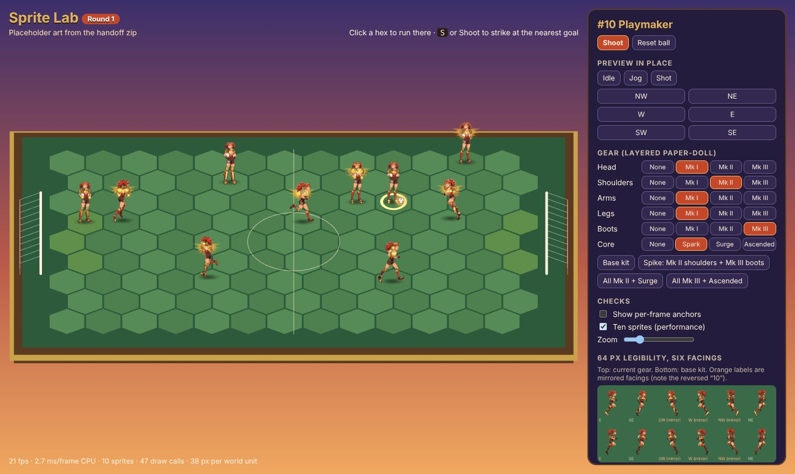
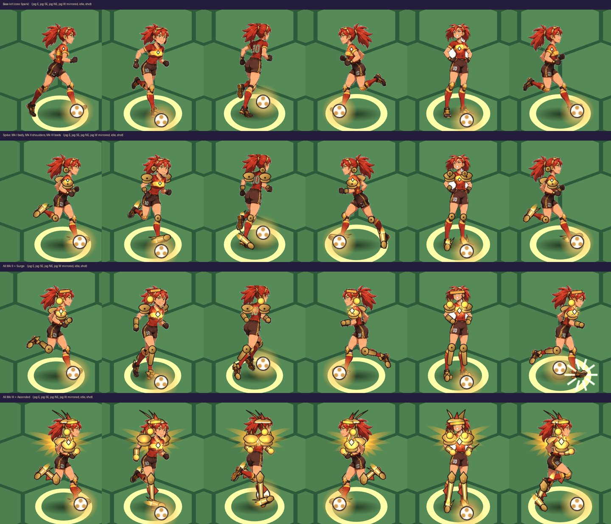
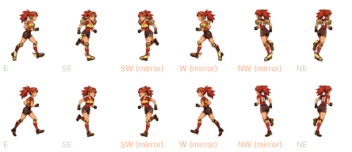

# 2D anime sprites: Round 1 vertical slice

Status: **for review (Round 1 of the 2D sprite handoff brief). Round 2 has not started.**

The player art pipeline moves from 3D humanoid models to hand-drawn 2D anime sprites in a fixed-camera
2.5D view. Gameplay is unchanged: 5-a-side, 13x9 hex pitch, roles, abilities, six visible upgrade slots
and Spark/Surge/Ascended cores. This folder covers the first slice: Emberforge playmaker #10 on the pitch.

## Run it

```bash
npm install
npm run dev
```

Open http://localhost:5173/sprite-lab.html (or follow the link at the bottom of the main page).

- Click a hex to run there (the path is previewed under the cursor). Click another player to select them.
- Press **S** or **Shoot** to strike at the nearest goal. The ball leaves her foot on the shot's
  `ball_release` event and flies on its own.
- **Preview in place** plays idle, jog or shot in any of the six hex facings.
- **Gear** sets each slot to None or Mk I-III (core: Spark, Surge, Ascended). Presets include the brief's
  spike case: Mk II shoulders + Mk III boots on a Mk I body.
- **Checks**: show per-frame anchors, add nine more sprites for the performance test, zoom, and a live
  strip of all six facings at 64 px tall (current gear on top, base kit below).

A different sprite sheet can be tested with `sprite-lab.html?atlas=/path/to/sheet.json`.





## How it fits the existing code

| Piece | Where |
| --- | --- |
| Atlas contract (frames, anchors, actions, events) | `src/sprites/schema.ts` |
| Hex facing to drawn view (and mirroring) | `src/sprites/facing.ts` |
| Atlas loading, frame resolution, per-step transforms | `src/sprites/atlas.ts` |
| Upgrade slots, tiers, presets | `src/sprites/loadout.ts` |
| Placeholder gear drawn on anchors | `src/sprites/gear.ts` |
| Paper-doll compositor | `src/sprites/compose.ts` |
| three.js pitch, sprite player, lab page | `src/lab/`, `sprite-lab.html` |
| Placeholder atlas + JSON | `public/sprites/playmaker10/` |
| Scripts that cleaned and packed the handoff frames | `tools/sprites/` |

The pitch uses the rules engine's hex grid (`src/engine/hex.ts`: pointy-topped, odd-r rows), so sprite
positions come straight from engine `Hex` values. The engine is untouched.

Rendering, per the brief's Stage A: an orthographic three.js camera looks north at about 39 degrees. Hexes,
goals and markings are meshes. Each player is one camera-facing quad whose texture is a 256x352 canvas;
the compositor redraws that canvas only when the frame, facing or gear changes (plus 12 Hz for glowing
gear). The foot pivot (0.5, 0.97) sits on the hex centre, the shadow and selection ring are separate ground
meshes, and the ball is its own sprite. Sprites and the ball are depth-sorted by distance to the camera.

## What is placeholder and what is still conceptual

Placeholder (replace, do not ship):

- **Jog frames** are Déan's 12 handoff frames (3 views x 4), cleaned by `tools/sprites/clean_prototype.py`:
  baked grey shadows and baselines removed, each view row scaled to one height and moved onto the shared
  foot pivot. Pale edge halos and uneven motion from the automatic crop are still there.
- **Idle** is the hands-on-hips figure cut out of the concept sheet (`extract_stand.py`), front view only,
  with a 2-frame breathing scale. It is used for every facing, so she turns to face the camera when she stops.
- **Shot** has no drawings yet. It is assembled from side jog frames with small rotations and nudges,
  and is side-view only (other facings fall back to side). The timing, the `wind_up`, `foot_contact` and
  `ball_release` events and the ball flight are real; the poses are not a kick.
- **Gear** is vector placeholder art drawn onto measured anchors (brass, Emberforge colours, core glow
  `#ffb43c`). It proves layering and visibility, not the final look.
- **Anchors** were measured by hand from the placeholder frames (`tools/sprites/anchors_playmaker10.json`),
  accurate to a few pixels. Near/far limb calls on a few frames are guesses because the AI frames do not
  alternate legs cleanly.

Still conceptual (decided in Round 2 or later):

- Six-facing coverage. The slice mirrors the three drawn views for W, SW and NW. The 64 px strip shows the
  cost: the "10" on the shorts and back reads "01" when mirrored. Recommendation in
  [layered-upgrades.md](layered-upgrades.md).
- Painted gear overlays for deforming pieces, team metal variants, and the creature spirit art for Ascended.
- Real goal-mouth geometry, keeper, opponents, and any link to the rules engine's match flow.

## Round 1 acceptance checklist (from the brief)

| Check | Status |
| --- | --- |
| Same person in portrait, turnaround and small sprite | Not done. Needs the cleaned character sheet (art task). |
| Appealing, not pixel art, at pitch scale and 64 px | Placeholder frames read well at 64 px (see strip). |
| Clean transparent edges, no halo/background/text | Shadows and baselines removed; light halos remain. |
| Same foot pivot and proportions across frames | Done by the clean-up script; idle cut-out is slightly slimmer. |
| Idle/jog/shot coherent, shot contact exported as event | Events exported; shot poses are stand-ins. |
| Three views map to movement; six-direction plan | Done, plan below. |
| Hexes, ring, ball and depth sorting in current architecture | Done. |
| Mk II shoulder + Mk III boot proof | Done (Spike preset), all facings and actions. |
| Ten placeholder sprites without stutter | Measured, see below. |
| Editable sources, atlas + JSON + README | Atlas, JSON, scripts and this README. Source PSDs are an art task. |

**Performance.** Measured in headless Chromium with SwiftShader (software WebGL, no GPU) in a cloud
container, 1440x860. Ten sprites with random mixed gear, all running: about 2.7 ms CPU per frame for
game logic, compositing and three.js, 47 draw calls. Frame rate there is capped by software rendering
(about 21 fps with ten sprites versus about 30-40 with one), so the CPU time is the meaningful number. This
should be re-measured on a normal desktop browser with a GPU; it has not been yet.


